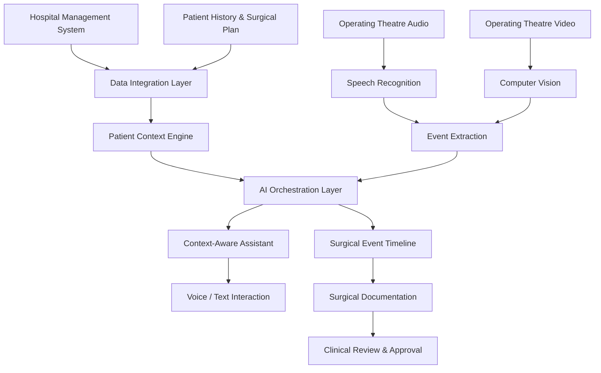
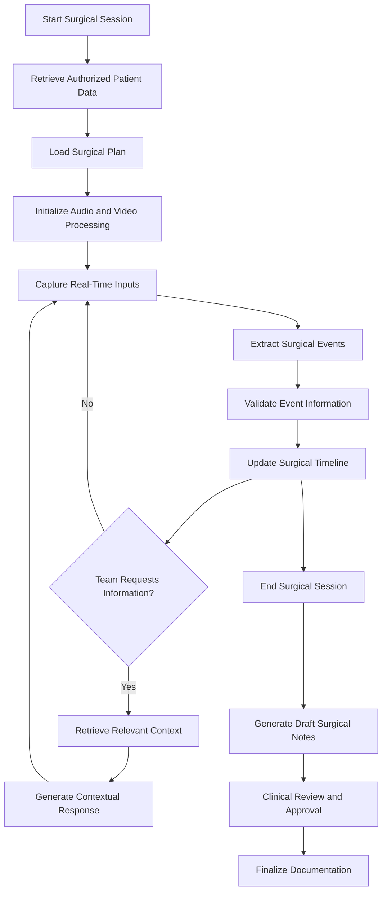

# 🏥 Neurova AI — Intelligent Operating Theatre Assistant

<p align="center">
  
  
  
</p>

<h3 align="center">
  An Intelligent AI Assistant for Smarter, Safer and More Connected Operating Theatres.
</h3>

<p align="center">
  <b>Real-Time Surgical Intelligence | Multimodal AI | Clinical Documentation | Context-Aware Assistance</b>
</p>

---

## 🚀 Overview

**SurgiSync AI** is an AI-powered Operating Theatre Assistant designed to support surgical teams by bringing patient information, surgical plans, real-time operating room events, and post-operative documentation into one intelligent platform.

During surgical procedures, critical information is often distributed across Hospital Information Management Systems (HIMS), medical records, scans, surgical plans, and the knowledge of the operating team.

SurgiSync AI aims to bridge this information gap using Artificial Intelligence, Large Language Models (LLMs), Computer Vision, Speech Recognition, and intelligent workflow automation.

The platform aims to:

- Provide contextual access to patient information.
- Monitor and organize surgical events in real time.
- Help surgical teams retrieve relevant information through voice or text.
- Track instruments, medications, implants, and important timestamps.
- Generate structured surgical documentation from recorded events.

**Our vision:** Transform fragmented operating theatre information into a unified, intelligent and traceable surgical information system.

---

## 🎯 Problem Statement

### The Operating Theatre Assistant

During surgery, surgical teams must coordinate multiple activities simultaneously:

- Following surgical procedures and planned steps.
- Calling and handling surgical instruments.
- Administering medications.
- Placing implants.
- Managing unexpected complications.
- Monitoring critical timings.

However, important information is often scattered across patient records, scans, surgical plans, and the team's memory.

After surgery, surgeons frequently prepare operation notes from memory, potentially resulting in missing timings, instrument details, implant information, and procedural events.

### Our Proposed Solution

SurgiSync AI aims to provide an intelligent assistant that:

1. Understands patient information and planned surgical procedures.
2. Processes authorized audio and visual inputs from the operating theatre.
3. Identifies and organizes relevant surgical events.
4. Retrieves patient-specific information when requested.
5. Maintains a structured timeline of the operation.
6. Generates draft surgical notes for clinical review.

---

## 💡 Key Features

| Feature | Description | Technology |
|---|---|---|
| 🧑‍⚕️ Patient Context Intelligence | Retrieves relevant patient history, allergies and surgical plans | RAG + LLM |
| 🎙️ Voice Intelligence | Converts operating room conversations into structured information | Speech-to-Text |
| 👁️ Visual Intelligence | Explores recognition of surgical instruments and events | Computer Vision |
| 🧠 Context-Aware AI Assistant | Answers questions using authorized patient and procedure information | LLM + RAG |
| ⏱️ Surgical Timeline | Records important events and timestamps | Event Processing |
| 💊 Medication Tracking | Organizes medication-related events for verification | Structured Extraction |
| 🦾 Instrument & Implant Tracking | Identifies and records instrument and implant information | Computer Vision + Database |
| 📋 Automated Documentation | Generates draft operation notes from verified event records | LLM + Templates |

---

## 🏗️ System Architecture

The proposed system follows a modular, multimodal AI architecture.



*Note: This represents the proposed architecture, not a clinically validated implementation.*

---

## ⚙️ Technology Stack

### Artificial Intelligence & Machine Learning

- Python
- Large Language Models (LLMs)
- LangChain
- LangGraph
- Retrieval-Augmented Generation (RAG)
- Natural Language Processing (NLP)

### Computer Vision

- OpenCV
- YOLO
- Image Processing
- Object Detection

### Speech Processing

- Faster Whisper
- Speech Recognition
- Audio Processing
- Voice Activity Detection

### Backend & APIs

- FastAPI
- REST APIs
- WebSocket Communication

### Database & Storage

- PostgreSQL
- Vector Database
- MongoDB (optional)
- Secure Document Storage

### Frontend

- React.js
- JavaScript
- Tailwind CSS
- Real-Time Dashboard

### Deployment & Infrastructure

- Docker
- Git & GitHub
- Cloud Infrastructure

---

## 🔄 Core Workflow



---

## 🌟 Innovation & Differentiators

Our goal is to go beyond a conventional healthcare chatbot.

### 1. Multimodal Surgical Intelligence

Combine audio, video, structured patient information, and surgical plans to build a unified understanding of the operating theatre environment.

### 2. Context-Aware Patient Assistant

Instead of answering generic medical questions, the assistant retrieves relevant information from the authorized patient's records and planned procedure.

### 3. Event-Based Surgical Memory

Maintain a chronological, structured record of important surgical events, including:

- Medication administration events.
- Instrument usage events.
- Implant-related events.
- Procedure milestones.
- Important timestamps.

Each event should retain its source and verification status.

### 4. Evidence-Based Surgical Documentation

Generate draft operation notes using structured event records rather than relying exclusively on post-operative recollection.

### 5. Human-in-the-Loop Verification

Critical information must be verified by authorized clinical staff. The AI must not independently make surgical decisions, prescribe treatment, or control clinical equipment.

---

## 📂 Project Structure

```text
SurgiSync-AI/
│
├── backend/
│   ├── app/
│   │   ├── main.py
│   │   ├── api/
│   │   ├── services/
│   │   ├── agents/
│   │   └── schemas/
│   │
│   └── requirements.txt
│
├── frontend/
│   ├── src/
│   │   ├── components/
│   │   ├── pages/
│   │   └── services/
│   └── package.json
│
├── ai_engine/
│   ├── rag/
│   ├── nlp/
│   ├── speech/
│   ├── computer_vision/
│   └── event_detection/
│
├── data/
│   ├── sample_patient_data/
│   ├── surgical_documents/
│   └── synthetic_data/
│
├── database/
│   ├── models.py
│   └── schemas.py
│
├── docs/
│   ├── architecture.md
│   └── workflow.md
│
├── tests/
│
├── .env.example
├── .gitignore
├── Dockerfile
├── docker-compose.yml
└── README.md
```

---

## 🛠️ Installation & Setup

### Prerequisites

- Python 3.10+
- Node.js 18+
- Git
- PostgreSQL
- API credentials for the selected LLM provider

### 1. Clone the Repository

```bash
git clone https://github.com/YOUR_USERNAME/SurgiSync-AI.git

cd SurgiSync-AI
```

### 2. Backend Setup

```bash
cd backend

python -m venv venv
```

Activate the virtual environment:

**Windows:**

```bash
venv\Scripts\activate
```

**Linux / macOS:**

```bash
source venv/bin/activate
```

Install dependencies:

```bash
pip install -r requirements.txt
```

### 3. Configure Environment Variables

Create a `.env` file in the backend directory.

```env
LLM_API_KEY=your_api_key
DATABASE_URL=your_database_url
VECTOR_DB_PATH=./vector_store
```

Never commit API keys, patient information, or other sensitive credentials to GitHub.

### 4. Start Backend

```bash
uvicorn app.main:app --reload
```

### 5. Frontend Setup

```bash
cd frontend

npm install

npm run dev
```

---

## 🔐 Security, Privacy & Clinical Safety

Healthcare data requires strict protection.

SurgiSync AI is designed with the following principles:

- Patient data privacy and confidentiality.
- Role-based access control.
- Encryption for data in transit and at rest.
- Secure authentication and authorization.
- Audit logs for data access and AI-generated outputs.
- Consent-based audio/video processing.
- Human verification of critical clinical information.
- Clear identification of uncertain or unverified events.

The prototype must use synthetic or appropriately authorized data. It is not intended to replace qualified medical professionals or independently direct surgical procedures.

---

## 🗺️ Development Roadmap

| Phase | Development Goals | Status |
|---|---|---|
| Phase 1 | Problem analysis and architecture | 🔄 Planning |
| Phase 2 | Patient data integration | ⏳ Upcoming |
| Phase 3 | RAG-based patient context retrieval | ⏳ Upcoming |
| Phase 4 | Speech recognition and event extraction | ⏳ Upcoming |
| Phase 5 | Computer vision integration | ⏳ Upcoming |
| Phase 6 | Surgical timeline generation | ⏳ Upcoming |
| Phase 7 | Automated documentation | ⏳ Upcoming |
| Phase 8 | Dashboard and integration | ⏳ Upcoming |
| Phase 9 | Testing and prototype demonstration | ⏳ Upcoming |

---

## 📊 Expected Impact

SurgiSync AI aims to improve the organization and accessibility of operating theatre information.

| Area | Intended Benefit |
|---|---|
| Information retrieval | Faster access to relevant patient information |
| Surgical coordination | Better visibility of recorded events |
| Documentation | Reduced dependence on memory-based note preparation |
| Traceability | Structured and timestamped event records |
| Information accuracy | Evidence-backed outputs with human verification |

Actual improvements in time, accuracy, and workflow efficiency will be measured during testing rather than assumed.

---

## 🧪 Testing & Evaluation

The project will be evaluated using:

- Accuracy of patient information retrieval.
- Speech transcription quality in noisy environments.
- Precision and recall of event extraction.
- Instrument recognition performance.
- Timestamp accuracy.
- Completeness of generated surgical notes.
- Correct handling of missing or uncertain information.
- Data security and access-control testing.

---

## 🤝 Team & Contributions

We welcome contributions, ideas, and technical improvements.

If you want to contribute:

1. Fork the repository.
2. Create a feature branch.
3. Commit your changes.
4. Push the branch.
5. Submit a Pull Request.

```bash
git checkout -b feature/your-feature

git add .

git commit -m "Add: your feature"

git push origin feature/your-feature
```

---

## 🏆 Hackathon Project

**Hackathon:** Srujana Hackathon Series – Batch 3

**Problem Statement:** 01 – The Operating Theatre Assistant

**Industry:** Healthcare Technology / Medical AI

**Project:** SurgiSync AI

**Organization:** Biorad Medisys

---

## 👨‍💻 Contributors

| Name | Role | GitHub |
|---|---|---|
| Team Lead | AI/ML Engineering | [GitHub](https://github.com/) |
| Contributor 2 | Backend Development | [GitHub](https://github.com/) |
| Contributor 3 | Frontend Development | [GitHub](https://github.com/) |
| Contributor 4 | AI Integration | [GitHub](https://github.com/) |

*Update contributor details with actual team information.*

---

## 📌 Our Vision

> "An intelligent operating theatre where critical information is accessible, surgical events are traceable, and clinical documentation is supported by reliable AI."

**SurgiSync AI — Connecting Surgical Intelligence with Real-World Healthcare.**

---

<p align="center">
  ⭐ If you find this project interesting, consider starring the repository!
</p>

<p align="center">
  <b>Built with ❤️ for Healthcare Innovation.</b>
</p>
